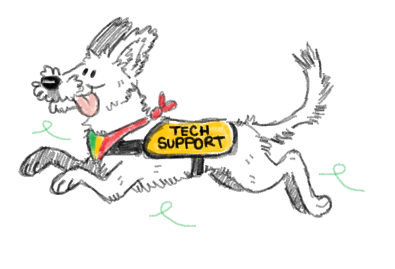

Welcome to **Eufurria**  🐾✨

Eufurria isn’t just about art and events.
Our platform hosts custom-built solutions, including bots and other tools, designed to enhance our community experience.
From managing events to enabling interactions, our codebase helps bring the community closer.

## 🔮 Vision

Members should enjoy the tech around Eufurria. It should feel engaging and fun to use, and stay reliable and easy to maintain behind the scenes.

## 🤝 Values

The bots, the tools, and the website are here so members can find each other, organise events, and feel at home, on Discord, on Telegram, and on the web.

Concretely, that means:

- [eufurria.org](https://eufurria.org) stays accurate, welcoming, and easy to move through in both PT and EN.
- The bots are looked after so Discord and Telegram carry the feel of *Eufurria*.
- New IT and dev volunteers get a clear way in, so the work never sits on one person.
- Uptime, security, and backups are watched, so members can trust the platforms and not have to think about them.

## ⭐ North star

**Users stay in front. That is where the development effort belongs.**
We think as members. The staff view, and the volunteer view, come after that.
What would help? What can we improve? How do we remove friction? That is the goal.
***What we decide, what we build, what we write down, what we prioritise: it has to trace back to this.***
Leave a change alone until it makes the website, Discord, or Telegram better for the people using them.

## 💬 Join us

Art, creativity, and the community are at [eufurria.org](https://eufurria.org).

## Contributing

Members are welcome to improve a bot or build something new. Onboarding, guidelines, and the detailed instructions live in the Eufurria Wiki. Ask the moderation team if you need access to the Wiki or the internal tools.

## 🐾 License

This project is licensed under the MIT License. See the [LICENSE](LICENSE) file for details.

---

  

